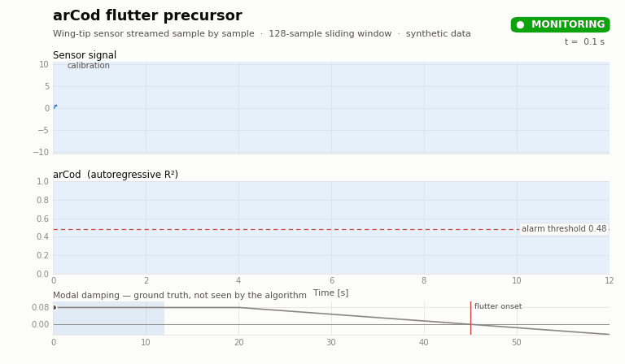

# Data-Driven Aeroelastic Flutter Precursor

[](https://github.com/bmeivar/flutter/actions/workflows/tests.yml)

Code for **"Data-Driven Approach to the Development of an Aeroelastic Flutter Precursor"**
by Boaz Meivar and Moti Karpel (Technion), *AIAA Journal*, Vol. 63, No. 1, 2025, pp. 174–183,
[doi:10.2514/1.J064327](https://doi.org/10.2514/1.J064327).
An earlier version was presented at AIAA SciTech 2022 ([doi:10.2514/6.2022-0522](https://doi.org/10.2514/6.2022-0522)).

The method flags an impending flutter event using **only measured sensor signals**, with no model of
the aircraft or of the flutter mechanism.



*The sensor signal is streamed one sample at a time, and the plots scroll with the last 12 s.
As the modal damping (bottom strip: ground truth, never seen by the algorithm) decreases toward
zero, the response becomes more regular and **arCod** rises above its threshold. The warning
(shaded) is issued 7.0 s before flutter onset (damping = 0). The signal is synthetic: one
4.4 Hz mode driven by turbulence, with nonlinear damping that turns the post-flutter response into a
limit cycle (see [`examples/demo_signal.py`](examples/demo_signal.py)).*

## Method

Three stages, all computed over a sliding window of 128 samples:

1. **Regularity features.** Each one measures how regular (periodic) the signal is. Flutter onset is
   dominated by one mode and frequency, so measurements become more regular as flutter approaches.
   - **arCod** *(new)*: the coefficient of determination (R²) of an order-2 autoregressive linear fit
     to the window itself. It is ≈0 for noise and ≈1 for a sine wave.
   - **U-val** *(new)*: the sum of the magnitude spectrum after scaling its peak to 1.
   - **Spectral Entropy**: the Shannon entropy of the normalized power spectrum.
   - **Lempel–Ziv Complexity**: the complexity of the signal binarized at its median.
2. **Calibration.** White noise is added to nominal (pre-flutter) measurements until the median arCod
   drops to 0.16, the start of the feature's most sensitive range. This puts every sensor in the same
   detection range, whatever its location, quality or noise level.
3. **Thresholding.** Thresholds are set once, by Otsu's method on wind-tunnel data, and then reused
   unchanged on a different platform in flight. Defaults: arCod 0.48, Spectral Entropy 0.6,
   LZC 1.15, U-val 14.

In the A3TB UAV flight test, this gave flutter warnings up to 6 s before critical onset.

## Quick start

```bash
pip install -e ".[dev]"                # or: pip install -r requirements.txt
python flutter_precursor.py            # example on a synthetic signal
python examples/make_readme_gif.py     # regenerates assets/arcod_demo.gif (needs ffmpeg)
pytest                                 # feature unit tests
```

Online use:

```python
from flutter_precursor import flutterFeatureExtractor

ext = flutterFeatureExtractor("wing_tip_gyro", windowSize=128,
                              calibrationFactor=0, calibrationFlag=False)
for i, sample in enumerate(stream):
    ext.get_measurement(sample)
    if i == nominal_end:               # calibrate once on nominal-flight data
        ext.calibrationFlag = True
        ext.calibration(nominal_start, nominal_end)
    if ext.arCod and ext.arCod[-1] > ext.threshold_arcod:
        print("flutter warning")
```

## Repository layout

| Path | Contents |
|---|---|
| `flutter_precursor.py` | Feature extractor: arCod, U-val, Spectral Entropy, LZC, and calibration |
| `examples/demo_signal.py` | Synthetic flutter-approach signal (Hopf onset plus limit cycle) |
| `examples/make_readme_gif.py` | Script that renders the GIF above |
| `tests/` | Unit tests: windowing, and feature trends from noise to sine (paper Fig. 7) |

## Citation

```bibtex
@article{meivar2025flutter,
  author  = {Meivar, Boaz and Karpel, Moti},
  title   = {Data-Driven Approach to the Development of an Aeroelastic Flutter Precursor},
  journal = {AIAA Journal},
  volume  = {63},
  number  = {1},
  pages   = {174--183},
  year    = {2025},
  doi     = {10.2514/1.J064327}
}
```

## License

MIT. See [LICENSE](LICENSE).

## Acknowledgments

Wind-tunnel and flight-test data were provided by Prof. Daniella Raveh, Technion Faculty of Aerospace
Engineering.
